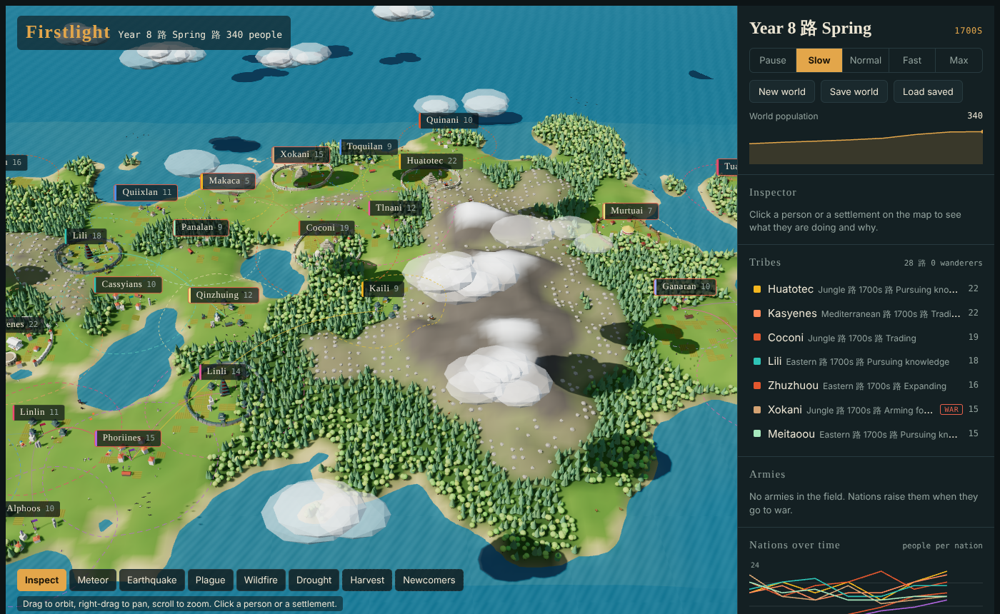
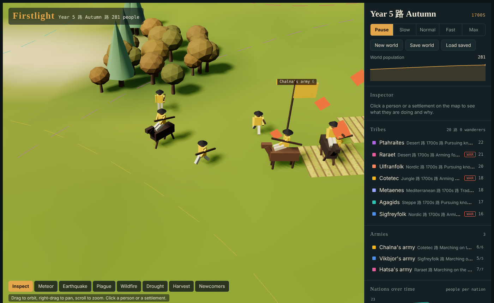
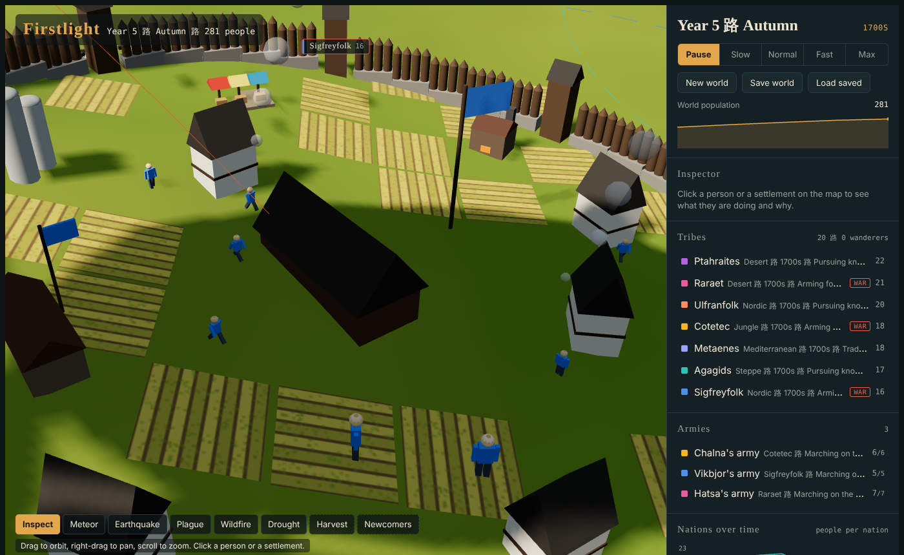
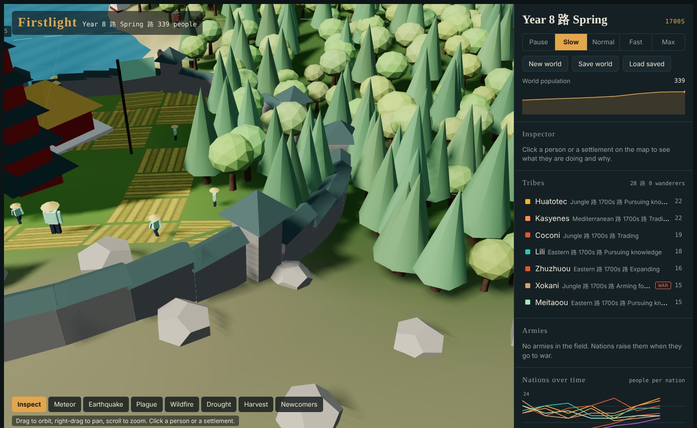

# Firstlight

**Watch AI nations grow their own civilization on a living 3D map.**

You don't play a nation in Firstlight. You watch the world. Hundreds of people gather food, farm, build and have children. They form tribes that grow into nations, and every nation has a council AI and a ruler of its own. Nations trade, found religions, invent technology, raise wonders, sign alliances and go to war on land and sea. You can speed up time, read the history as it happens, and step in with earthquakes, plagues or a good harvest.



## Play

Firstlight is one HTML file with no build step.

- **Locally:** open `index.html` in a modern browser.
- **Hosted:** put the repo on any static host, such as Vercel, Netlify or GitHub Pages. `vercel.json` is already set up.

Pick a starting era from the **Stone Age** to the **2000s**. You can also enter a world seed to replay the same map.

## What happens in a world

### People
Every person has a name, an age, hunger, health and four personality traits: aggression, sociability, curiosity and diligence. Each person decides what to do next by weighing their needs against their tribe's plan: forage, hunt, farm, quarry stone, build, trade, think up new ideas, raid, or march to war. Click anyone to see what they're thinking.

People also live everyday lives:
- **Jobs:** each adult has a job, from hunter, farmer, fisher and herder to smith, potter, priest, healer, teacher, artist, factory worker, engineer and programmer. A job shapes what they do all day.
- **Needs:** people get tired and rest at home, and they get lonely and go chat with friends about the harvest, the war, the chief or news from across the sea.
- **Family:** people court and marry, couples raise children, elders tell stories to the young, and families mourn their dead at the town graveyard.
- **Festivals:** wealthy, pious towns hold festivals like the Lantern Festival or the Midsummer Feast, and everyone dances in the square.
- **Body language:** you can see people sit to rest, kneel to pray, dance, chop wood, hoe fields, fish with a rod and carry loads home. The Inspector shows each person's job, mood, partner, children and best friend.

### Each culture looks its own
Houses have doors, windows, roofs and decorations in their culture's style: Nordic longhouses with shields and carved gables, desert adobe with wooden beams and awnings, Eastern houses with red pillars and lanterns, Mediterranean villas with shutters and cypress trees, jungle houses with painted friezes, and Steppe yurts. Shutters, awnings and banners use each nation's own color. People wear their culture's traditional dress, and early navies sail Viking longships, Chinese junks and Nile feluccas.

### Nations and their AI
- **Council AI:** every year each nation sizes up its food, housing, neighbors and threats, then picks a plan: *grow, expand, fortify, arm for war, pursue knowledge* or *trade*. It learns from how well its last plan worked.
- **Rulers with personalities:** a ruler can be a Warlord, a Merchant, the Wise, or a Builder, and that tilts the nation's choices.
- **Six cultures:** Steppe, Nordic, Desert, Eastern, Mediterranean and Jungle. Each has its own names, homes, walls, wonders, dress and temperament.
- **Diplomacy:** relations rise and fall with borders, trade and faith. Nations form alliances, declare wars, surrender and pay tribute.
- **Faiths:** nations found religions that spread along trade routes. A shared faith brings nations closer, and a rival faith can start a holy war.

### War


- **Armies** muster, march in formation behind a general with a banner, and route around mountains and lakes.
- **Battles** are named after the land they're fought on, for example *"Battle of Batu Plain"*. An army that loses enough soldiers breaks and flees.
- **Sieges** wear down walls, then sack the town or conquer it outright. Defenders raise their own army to meet invaders.
- **Navies** of canoes, galleys, galleons, ironclads and destroyers fight at sea and bombard harbors.
- **Air power**: once a nation learns Flight it sends bombers and fighters into the sky. Planes dogfight, get shot down, and strike enemy towns. Propeller fighters give way to jet fighters that fire missiles.
- **Submarines** hunt under the waves, invisible until they surface or come close, and sink ships with torpedoes.
- **Artillery** rolls behind modern armies and shells the enemy, **helicopters** fly over them, and **anti-aircraft guns** in modern towns shoot down raiders.
- Weapons change with the era: spears and bronze, then cavalry, muskets, rifles and finally tanks.

### Explorers and the sea
Nations with Sailing send captains and settlers across the sea. When they reach an empty shore, they found an allied colony there. If their ship is sunk, the whole expedition is lost.

- **Islands** dot the open sea, and explorers are drawn to settle them.
- **Merchant ships** sail between harbors, from small trading cogs to container ships stacked with cargo. Each voyage trades goods, spreads ideas and builds friendship, and opens a sea route. Pirates sometimes seize a cargo.
- **Island communication** improves with the ages. Merchant ships carry the news at first. Then come undersea telegraph cables, radio, satellite links and fiber-optic internet cables. You can see cables on the seabed and messages flying through the sky. Linked nations grow friendlier and share ideas each year, and war cuts the link.
- **Sea life:** whales spout, dolphins leap, fish swirl in shoals and fishing boats work the coast near harbor towns.

### Towns that grow with the ages


Towns grow from huts to cities, and each culture builds its own style of home and wall. Over time they add **barracks, granaries, markets, forges, temples, castles, libraries, universities, observatories, arenas, windmills, hospitals, railway stations, statues, radio towers, airfields, data centers, power plants, wind turbines and stadiums**, plus three wonders per nation. Port towns build harbors and lighthouses. Roads link trading partners and get paved as the eras pass.



### Technology
There are **53 technologies** across seven eras. They run from Stone Tools, Fire and Agriculture through Bronze, Writing, Castles, Gunpowder, Printing, Steam, Railways, Electricity, Flight and Radio, up to Computers, Robotics, Satellites and Drones. Ideas spread between neighbors and trading partners. You can see what a nation knows on the map:

- **Railways:** trains run between trading towns.
- **Electricity:** power lines run between towns.
- **Flight:** airliners fly between friendly nations.
- **Robotics:** some workers are robots.
- **Satellites:** satellites circle high above the world.
- **Drones:** drones buzz over armies.

### A living world
- Seasons change every year: green summers, autumn colors and snowy winters.
- Wild herds of deer and boar graze the wilderness and disappear as towns claim the land.
- Sheep, goats, cattle and llamas graze around farming towns, depending on the culture.
- Birds circle overhead, chimneys smoke (factory smoke is darker), and clouds drift past with their shadows.

### History
Everything that happens goes into the **Chronicle**: wars, battles, sieges, golden ages, rebellions, new faiths, discoveries, wonders and the fall of nations. Charts track the world's population and each nation's rise and fall.

## Controls

| Action | How |
| --- | --- |
| Orbit, pan or zoom | Drag, right-drag, or scroll |
| Inspect a person or town | Click it on the map |
| Follow someone | Select them, then **Follow with camera** |
| Follow an army | Click it in the **Armies** panel or its map label |
| Speed | Pause, Slow, Normal, Fast or Max |
| Reshape the world | Meteor, Earthquake, Plague, Wildfire, Drought, Harvest, Newcomers, Volcano, Flood or Grow forest, then click the map |
| Meddle with a nation | Golden age, Gift knowledge, Prophet, Broker peace, Sow war, Raise army or Rebellion, then click near a town |
| Graphics | **Auto**, **Low** (phones and older PCs), **Medium** or **High**. Auto picks a level for your device and steps down if the game runs slowly. Your choice is remembered. |
| Save or load | **Save world** and **Load saved** store your world in this browser |

## How it's built

- **One file:** `index.html` holds both the simulation and the 3D view. [three.js](https://threejs.org) r147 loads from a CDN.
- **Simulation:** the code inside `<script id="sim-core">` is pure logic with no DOM, so it runs headless in Node. Everything that happens goes through `sim.emit()`, which feeds the Chronicle.
- **Rendering:** models are built from instanced primitive parts, so thousands of people, buildings and animals draw in a handful of draw calls.

## Tests

The simulation runs headless in Node:

```bash
node tests/run.js [era] [seed] [years]   # run a world and print stats and history
node tests/ai.js                         # council AI strategies
node tests/nudge.js                      # world tools (meteor, plague, ...)
node tests/tools.js                      # new tools (volcano, golden age, peace, ...)
node tests/war2.js                       # jets, submarines and anti-aircraft
node tests/sea.js                        # islands, merchant ships and sea links
node tests/life.js                       # jobs, marriage, festivals and everyday life
node tests/save.js                       # save and load round trip
node tests/army.js                       # armies, battles and sieges in four eras
```
